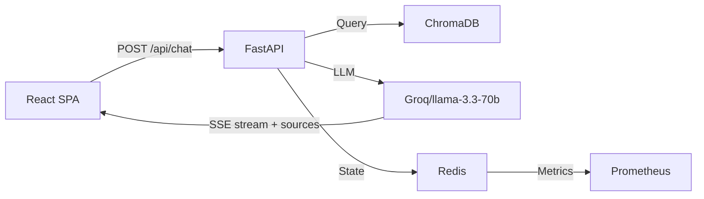

---
tags:
  - architecture
aliases: [System Design, Data Flow]
---

# Architecture

## Layers

| Directory | Role |
|-----------|------|
| `frontend/` | React 19 SPA — chat, graph, node panels |
| `backend/` | FastAPI — chat routes, RAG pipeline, agents |
| `rust-gitmind/` | Rust — git analysis, AST parsing |
| `rust-sidecar/` | Rust — supplementary services |

## Backend Services

| Service | File | Storage | Mode |
|---------|------|---------|------|
| Cache | `services/cache.py` | Redis | Retry 3x, production fail-fast |
| Session | `services/session.py` | Redis hash + TTL | Dev fallback: in-memory OrderedDict |
| Task Queue | `services/task_queue.py` | Redis List (LPUSH/BRPOP) | Registry pattern, 3 workers |
| Rate Limiter | `services/rate_limiter.py` | Redis sorted set + Lua script | Dev fallback: in-memory |
| LLM Cache | `llm_cache.py` | Redis primary + diskcache fallback | 24h TTL, 2GB disk cap |
| Telemetry | `services/telemetry.py` | Prometheus + OpenTelemetry | OTLP exporter optional |

## Data Flow

1. User asks question in [[Notes/Development|React SPA]]
2. `POST /api/chat/stream` → FastAPI SSE endpoint
3. FastAPI queries ChromaDB (vector embeddings) — returns source filepaths
4. LLM generates response with RAG context
5. SSE stream returns tokens + source metadata to frontend
6. `SourceBadge` components render file citations in chat
7. All state (sessions, tasks, cache, rate limits) stored in Redis

## Key Design Decisions

| Decision | Choice | Why |
|----------|--------|-----|
| Vector DB | ChromaDB | Local, no infra, fast for repo-sized data |
| LLM provider | Groq | Low latency, good code reasoning |
| Streaming | SSE | Real-time token delivery, simple protocol |
| Frontend | CRA + react-app-rewired | Stable, well-understood build |
| State store | Redis-only | Crash in prod if unavailable, memory fallback in dev |
| Task queue | Redis List + registry | Atomic LPUSH/BRPOP, no pickled coroutines |
| Rate limiting | Redis sorted set + Lua | Atomic sliding window, per-endpoint limits |

## Source Files

| File | Purpose |
|------|---------|
| `backend/routes/chat.py` | Chat SSE endpoint (tokens + sources) |
| `backend/agents/chat.py` | LangChain agent with RAG + source extraction |
| `backend/services/cache.py` | Redis client with retry logic |
| `backend/services/task_queue.py` | Background task queue (Redis List) |
| `backend/services/session.py` | Session store (Redis hash) |
| `backend/services/rate_limiter.py` | Sliding-window rate limiter |
| `backend/llm_cache.py` | LLM response cache (Redis + diskcache) |
| `frontend/src/api.js` | `postChatStream()` SSE client |
| `frontend/src/components/ChatTab.jsx` | Chat message list + SourceBadge |

## Related

- [[Notes/Tech Stack|Tech Stack]] — technologies used
- [[Notes/Development|Development]] — how to run and test
- [[Tasks/Current|Current Tasks]] — active work
- [[Changelog/v0.1|Changelog]] — release history
