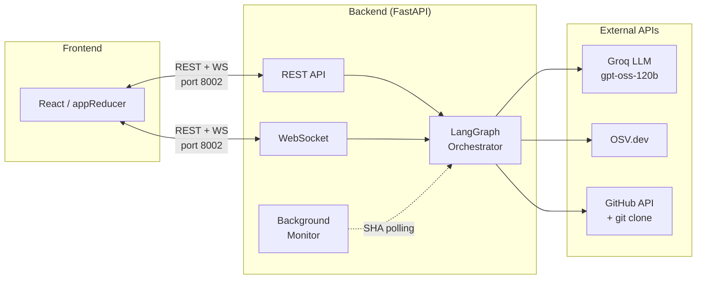
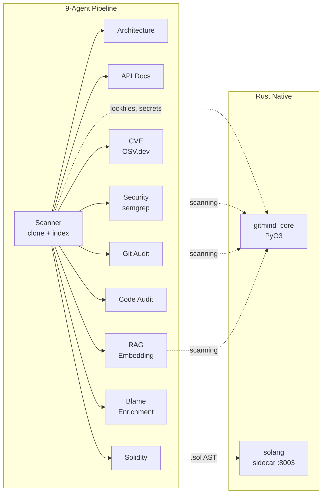
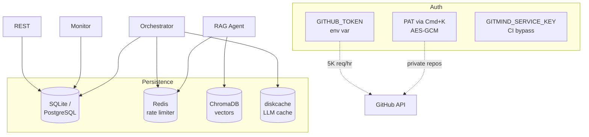

# Architecture

System overview, agent pipeline, storage and auth layers, and the Rust
native acceleration path.

## Architecture

### System Overview

### Agent Pipeline

All 9 agents run **in parallel** after scanning. Each is fully error-isolated — a failure returns safe defaults.

### Storage & Auth

> **Solid lines** = primary data flow. **Dashed lines** = indirect calls.

---

## Rust Native Acceleration

> **240 lines of Rust replace 341 lines of Python regex** — zero IPC overhead, compiled via PyO3.

| Function                 | Replaces                                     | Speed-up                        |
| ------------------------ | -------------------------------------------- | ------------------------------- |
| `parse_dependencies()`   | 12 lockfile parsers in Python                | Single-pass `RegexSet` matching |
| `scan_secrets()`         | Loop of 11 regex patterns                    | O(1) vs O(n) per file           |
| `scan_sensitive_files()` | File path pattern matching                   | Compiled regex                  |
| `scan_route_files()`     | Route detection                              | Single-pass                     |
| `compute_docs_score()`   | Comment/docstring ratio                      | RegexSet batch                  |
| `split_text()`           | LangChain's `RecursiveCharacterTextSplitter` | Compiled Rust                   |
| `batch_blame()`          | Per-finding subprocess calls                 | Single git invocation per file  |

### Solidity Sidecar

Standalone Axum HTTP server (port 8003) using `solang-parser` for Solidity AST extraction. Runs as a separate Docker container.
